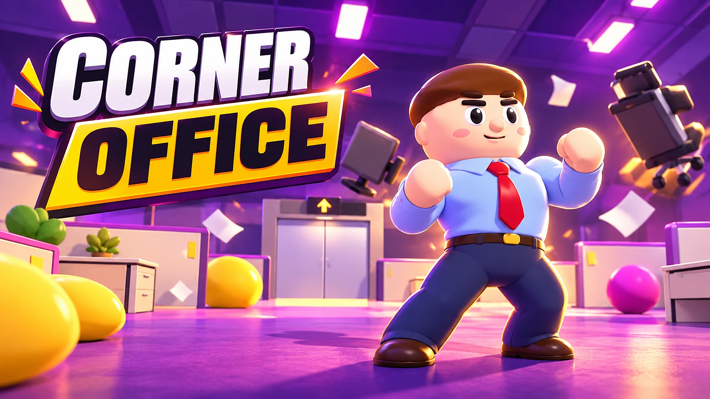
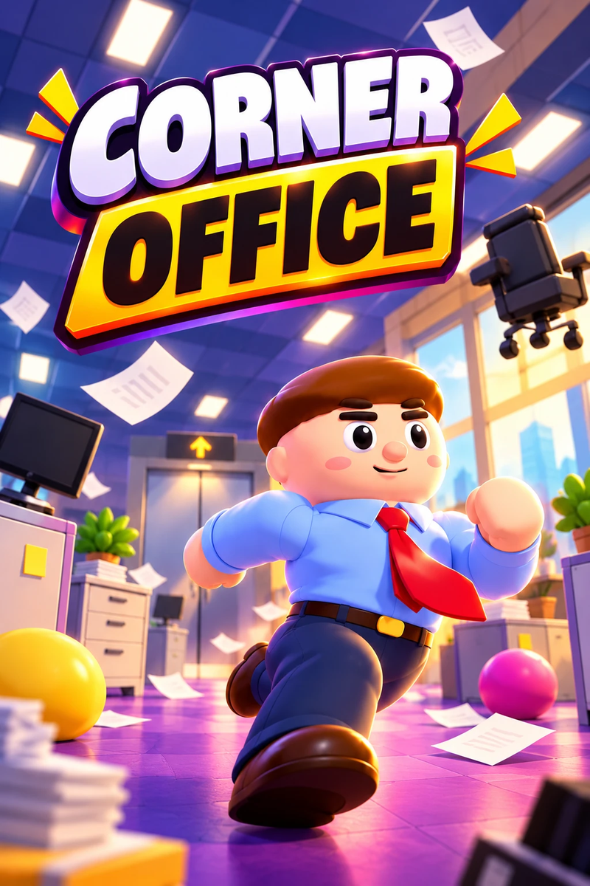
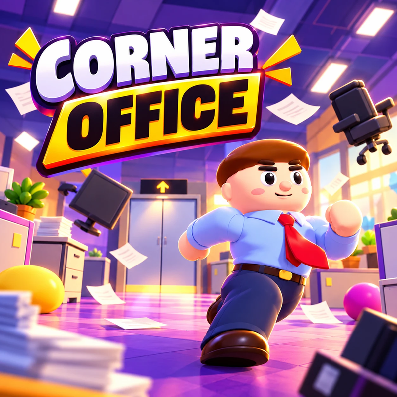

  

<h1 align="center">Corner Office</h1>

  <b>Your first day at Paperclip &amp; Co. and everyone wants you fired. Fight back!</b> 
  A physics brawler for your browser where every punch sends coworkers flying.

  

  <a href="https://playgama.ai/play/3ijupm2m3kc7dl"><b>playgama.ai/play/3ijupm2m3kc7dl</b></a> 
  Free, no download, no sign-up. Best on a PC with a mouse and keyboard.

---

## Trailer

  
   
  Click the cover to watch the trailer.

  🎬 <a href="media/trailer/trailer-landscape-1920x1080.mp4"><b>Trailer (landscape, 1920×1080)</b></a>
  &nbsp;•&nbsp;
  📱 <a href="media/trailer/trailer-portrait-1080x1620.mp4"><b>Trailer (portrait, 1080×1620)</b></a>

---

## About the game

Fight your way up the building floor by floor, from the Mailroom to the Rooftop. Use punches, combos, karate kicks and backflips, grab coworkers by the collar, slam them into the carpet, and throw monitors, boxes and staplers.

Clear a floor and ride the elevator up. On the way, pick a new move or a perk for your run: chain hits with Reply All, land Performance Review crits, or make fired coworkers explode with Hostile Takeover. Beat the Manager mid-building and the CEO on the roof to get headhunted by a bigger company with tougher coworkers and better pay.

Spend your salary in the Break Room on permanent upgrades. Watch your skinny new hire bulk up and work his way from inner wear to an executive suit. Climb the career ladder from Intern to CEO, play the Daily Shift with a new twist every day, and keep your login streak going for bonus cash.

## Features

- Over-the-top ragdoll physics with satisfying hits
- 8 department floors, each with its own look
- 5 companies to conquer, then endless star levels
- Boss fights against Managers and CEOs
- 18 perks and 6 special moves that combine into powerful builds
- Permanent upgrades that change your character's body and outfit
- Daily Shift challenge and login rewards
- Simple click-to-fight controls

## Controls

| Action | Input |
|---|---|
| Move | **WASD** or **arrow keys** |
| Attack (combo) | **Left click** (hold for a haymaker) |
| Pick up an item | **Left click** the item, left click again to throw it |
| Grab a coworker | **Right click**, right click again to throw, hold to slam |
| Kick | **F** |
| Pause | **Esc** |

Gamepad supported.

---

## Covers

| Landscape (1920×1080) | Portrait (800×1200) | Square (800×800) |
|:---:|:---:|:---:|
|  |  |  |

---

## Built with

- **Unity 6** (URP) for **WebGL**
- Custom active ragdolls (configurable joints with slerp drives, no third-party ragdoll plugins)
- Playgama Bridge SDK

  <a href="https://playgama.ai/play/3ijupm2m3kc7dl"><b>▶ Play Corner Office</b></a>

